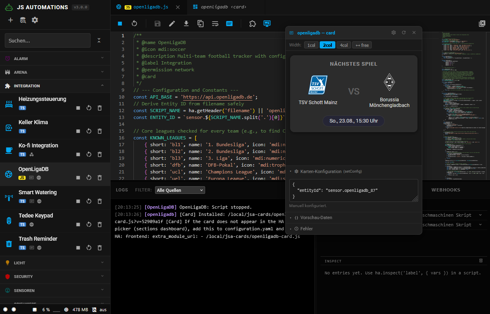

# JS Automations for Home Assistant


[](https://github.com/rocklobster42195/ha-js_automations_addon/actions/workflows/ci.yml)
[](https://ko-fi.com/rocklobster42195)

<p align="center">
  
</p>

**JS Automations** is a Home Assistant **add-on** for developers ready to leave YAML behind. Write automations in **Node.js** or **TypeScript**, run them in a secure, isolated environment, and control your home through a developer-grade `ha` API — complete with a built-in Web IDE.

> [!NOTE]
> **Actively evolving:** JS Automations is stable enough for daily/production use, but it's still a young project under active development. New features and improvements land regularly, so expect more frequent updates than a fully mature add-on — check the [releases](https://github.com/rocklobster42195/ha-js_automations_addon/releases) for what's new. Feedback and bug reports are always welcome!

> [!TIP]
> **Try the 3.2 beta — let an AI assistant work with your scripts.** The beta adds an **MCP server**: Claude Desktop (or any MCP client) can read your scripts and logs, find out why something does not run and — only if you allow it — write and restart scripts, or only propose changes that you confirm in your script list. It is off by default and every tool has its own switch. Look for **"JS Automations (Beta)"** in the Add-on Store; [how stable and beta coexist](https://github.com/rocklobster42195/ha-js_automations_addon/blob/main/js_automations_beta/README.md) (stop the stable add-on first). Feedback is very welcome: [open an issue](https://github.com/rocklobster42195/ha-js_automations_addon/issues).

> [!TIP]
> **API Reference:** Complete reference for all `ha` methods → [API Reference](https://github.com/rocklobster42195/ha-js_automations_addon/blob/main/docs/API_REFERENCE.md)

> **Script Library:** Browse and import ready-to-use scripts → [ha-jsa-library](https://rocklobster42195.github.io/ha-jsa-library/)

> **Deep Dive:** Internal architecture and advanced concepts → [Technical Documentation](https://github.com/rocklobster42195/ha-js_automations_addon/blob/main/docs/TECH-README.md)

---

## Why JS Automations?

Home Assistant offers several ways to automate. JS Automations is for people who want to write **real code** with a real editor, and still stay inside Home Assistant. It does not replace the others; many setups use more than one.

|                           | YAML automations                    | Node-RED                                   | AppDaemon                                      | **JS Automations**                                   |
| ------------------------- | ----------------------------------- | ------------------------------------------ | ---------------------------------------------- | ---------------------------------------------------- |
| **Language**              | YAML and Jinja templates            | Visual flows; JavaScript in function nodes | Python                                         | JavaScript, TypeScript or visual blocks (Blockly)    |
| **Editor**                | Home Assistant's own editor         | Browser flow editor                        | Your own editor (for example a VS Code add-on) | Built-in web IDE with autocomplete for your entities |
| **Complex logic**         | Limited to conditions and templates | Good, spread over many nodes               | A full programming language                    | A full programming language                          |
| **Failure isolation**     | Runs inside Home Assistant          | Flows share one process                    | Apps share one process                         | Every script runs in its own worker thread           |
| **Version history**       | Your own Git for `/config`          | Optional Git projects                      | Your own Git                                   | Built-in local Git, optional push to a remote        |
| **Best when you want to** | keep it simple and declarative      | think in flows and wire things visually    | write Python and reuse its libraries           | write JavaScript or TypeScript with an IDE around it |

Simple triggers are often best left as YAML automations. Reach for JS Automations when the logic grows: loops, state machines, API calls, your own entities, dashboard cards or anything you would rather test and read as code.

---

## Key Features

### Highlights

- **TypeScript-native with live IntelliSense** — Full autocomplete for your actual HA entities, services (including field types), and custom store keys, updated automatically as your home changes.
- **Integrated Web IDE** — Monaco editor with syntax highlighting, live logs, a real-time status bar and a smart snippet system. In Expert Mode: Event Inspector, a live REPL with full `ha` API access and Breakpoints (`ha.breakpoint()`) with a built-in variable inspector (**Settings → General → Expert Mode**).
- **Thread Isolation** — Every script runs in its own Worker Thread. Crashes are fully contained and never affect Home Assistant or other scripts.
- **Native HA Entities** — Register entities via MQTT Discovery with `ha.register()`; state is retained across reboots, and entities can be grouped under a named HA device. See the [Native Entities guide](https://github.com/rocklobster42195/ha-js_automations_addon/blob/main/docs/guide/native-entities.md).
- **Script Versioning (Git) and Backup** — Commit, browse history, compare versions and restore any file from a local Git repository, with an optional push to GitHub, GitLab, Gitea or any HTTPS Git host. Scheduled zip backups with retention, optional WebDAV upload and a disaster-recovery restore with an automatic safety snapshot. See the [Versioning guide](https://github.com/rocklobster42195/ha-js_automations_addon/blob/main/docs/guide/script-versioning.md) and the [Backup guide](https://github.com/rocklobster42195/ha-js_automations_addon/blob/main/docs/guide/backup-restore.md).
- **NEW (3.2 beta): MCP Server for AI assistants** — Let Claude Desktop (or any MCP client) list and read your scripts, check logs and errors and find out why something does not run. If you allow it, it writes and restarts scripts too — or only **proposes** changes that appear in your script list for you to confirm. One-click install for Claude Desktop, a switch for every tool, writing off by default, every change saved as a Git commit. See the [MCP guide](https://github.com/rocklobster42195/ha-js_automations_addon/blob/main/docs/guide/mcp.md).

### More features

**Writing automations**

- **Smart Triggers & Fluent API** — `ha.on()` supports wildcards, arrays, and RegExp; `ha.waitFor()` and `ha.waitUntil()` pause until a state or a multi-entity condition is reached; `await ha.entity('light.kitchen').turn_on({ brightness: 200 })` keeps sequential logic readable.
- **Visual Scripting (Blockly)** — Build automations by dragging blocks instead of writing code. A "Show Code" panel reveals the generated JavaScript live, and any block script can be duplicated as an editable `.js` file. See the [Blockly guide](https://github.com/rocklobster42195/ha-js_automations_addon/blob/main/docs/guide/blockly.md).
- **Deep HA API Access** — Jinja2 templates (`ha.renderTemplate()`), calendar and todo entities, label and floor registries, service response data (`returnResponse: true`), and the full HA event bus (`ha.onEvent()`, `ha.fireEvent()`).
- **History & Computed Helpers (`ha.history`)** — Raw state history and long-term statistics, plus `trend()`, `derivative()`, `integral()`, `stats()`, `timeSince()` and `timeInState()` on HA entities or any data array.
- **Global Libraries & Auto-NPM** — Write shared code once and `@include` it anywhere. npm packages listed in the script header are installed automatically.
- **Script Packs** — Embed a Lovelace card directly inside a script: backend logic and dashboard card in one file, installed automatically and connected via `__jsa__.callAction()`. See the [Script Packs guide](https://github.com/rocklobster42195/ha-js_automations_addon/blob/main/docs/guide/card-packs.md).

**Talking to the outside**

- **Direct MQTT Access (`ha.mqtt`)** — Subscribe to any broker topic and publish messages directly, with `+`/`#` wildcards and automatic JSON parsing.
- **Webhook Receiver (`ha.onWebhook`)** — Let external services push data into your scripts and get a real response back: your handler returns any HTTP status and body. Tokens are generated and managed by JSA. Requires a dedicated port; does not work through the Nabu Casa tunnel.
- **Filesystem API (`ha.fs`)** — Read, write, append, list, watch, and rotate files across three sandboxed roots: `internal://`, `shared://` (/share, NAS mounts), and `media://` (/media). Opt-in via Settings → Danger Zone.

**Data and safety**

- **Persistent Store & Secrets** — Share data between scripts or survive reboots with `ha.store` and `ha.persistent()`. Values can be marked as secrets, shared per script, and optionally encrypted at rest.
- **Capability Transparency** — Scripts declare `@permission network`, `@permission fs:write`, etc. in their header. The script list shows capability badges, warns about undeclared usage, and can enforce permissions at runtime. See the [Security model](https://github.com/rocklobster42195/ha-js_automations_addon/blob/main/docs/guide/security.md).

---

## Installation

### Home Assistant Add-on (Normal)

1. In Home Assistant, go to **Settings → Add-ons → Add-on Store**.
2. Click the **⋮** menu (top right) → **Repositories** and add:
   ```
   https://github.com/rocklobster42195/ha-js_automations_addon
   ```
3. Find **JS Automations** in the store and click **Install**.
4. After installation, go to the add-on's **Configuration** tab to set your preferences.
5. Start the add-on. Open the Web UI via the **Open Web UI** button.

> [!IMPORTANT]
> **MQTT Broker strongly recommended.** Entities registered via `ha.register()` use MQTT Discovery and require a broker (e.g. the [Mosquitto add-on](https://github.com/home-assistant/addons/tree/master/mosquitto)) to survive Home Assistant reboots. Without MQTT, registered entities will disappear after a restart. Problems? See [Troubleshooting & FAQ](https://github.com/rocklobster42195/ha-js_automations_addon/blob/main/docs/guide/troubleshooting.md).

### Local Development Setup

1. **Clone the repository** and navigate into the directory.
2. **Install dependencies:**
   ```bash
   npm install
   ```
3. **Start the server:**
   ```bash
   npm run dev
   ```
4. **Follow the setup wizard:** On the first run, a wizard will start in your terminal asking for your Home Assistant URL and a Long-Lived Access Token.
5. **Done!** The wizard creates a `.env` file, and the server starts. The UI is available at `http://localhost:PORT`.

---

## Quick Start: Hello World

Every script starts with a JSDoc-style header that configures the engine's behavior, then uses the `ha` object to talk to Home Assistant. This one file shows the core lifecycle end to end: a header, a native entity, and a reaction to a state change.

```javascript
/**
 * @name Hello World
 * @icon mdi:hand-wave
 * @description Minimal example: a metadata header, a native sensor, and ha.on()
 *              reacting to a state change to keep that sensor up to date.
 * @label Example
 * @expose switch
 */

const SOURCE = 'sun.sun'; // built into every HA instance, safe to reference here

ha.register('sensor.hello_world_greeting', {
  name: 'Hello World Greeting',
  icon: 'mdi:hand-wave',
});

function greet() {
  const isDaytime = ha.getStateValue(SOURCE) === 'above_horizon';
  ha.update('sensor.hello_world_greeting', isDaytime ? 'Good day!' : 'Good night!');
}

greet(); // set the initial value immediately, don't wait for the next sun change
ha.on(SOURCE, greet);

ha.log('Hello World script started.');
```

- **`@name`/`@icon`/`@description`/`@label`** — shown in the sidebar; `@label` groups scripts and, if a matching HA Label exists, inherits its icon and color (see [Creation Wizard](https://github.com/rocklobster42195/ha-js_automations_addon/blob/main/docs/guide/creation-wizard.md#what-label-and-area-actually-do)).
- **`@expose switch`** — exposes the _script itself_ as a toggle entity (`On` = running, `Off` = stopped). Use `@expose button` instead for a one-off action that (re)starts the script on press.
- **`ha.register()`** — creates a real HA entity via MQTT Discovery; see [Native Entities](https://github.com/rocklobster42195/ha-js_automations_addon/blob/main/docs/guide/native-entities.md).
- **`ha.on()`** — reacts to a state change; combine with `ha.update()`/`ha.entity()` to act on it.

The full header tag reference (`@npm`, `@include`, `@area`, `@permission`, `@card`, ...) and the complete `ha` API are in the [API Reference](https://github.com/rocklobster42195/ha-js_automations_addon/blob/main/docs/API_REFERENCE.md). The example itself lives at [`examples/hello_world.js`](https://github.com/rocklobster42195/ha-js_automations_addon/blob/main/examples/hello_world.js).

---

## TypeScript & IntelliSense

TypeScript support is built-in and requires zero configuration.

- **Live Entity Discovery:** Type definitions for your HA instance are generated automatically. `ha.states['` shows your actual entities with correct attribute types.
- **Typed Services:** `ha.call()` validates the domain, service name, and required fields.
- **Typed Store:** `ha.store.get()` and `ha.store.set()` are aware of your existing keys and their types.
- **Automatic Transpilation:** Save a `.ts` file — the internal **Compiler Manager** transpiles it immediately. No `tsc` commands needed.
- **Source Maps:** Error logs point to your original TypeScript source lines, not the compiled output.
- **Strict Mode:** Catches potential `null` and `undefined` errors before your script runs.

```typescript
interface WeatherData {
  temp: number;
  condition: string;
}

const weather = ha.persistent<WeatherData>('weather_cache', { temp: 0, condition: 'unknown' });
ha.log(weather.temp); // TypeScript knows this is a number
```

> **Pro Tip:** Global Libraries saved as `.ts` files can `export` types and functions. Use `@include my_lib.ts` and get full IntelliSense for your library in any script that includes it.

---

## Learn More

The topics below have grown too deep for a README section — each has its own guide with worked examples and (where a picture beats a paragraph) screenshots:

- **[Migrating from ioBroker](https://github.com/rocklobster42195/ha-js_automations_addon/blob/main/docs/guide/iobroker-migration.md)** — ID mapping, API translation table and a worked example; also drives the AI prompt that converts ioBroker scripts.
- **[MCP Server (AI assistants)](https://github.com/rocklobster42195/ha-js_automations_addon/blob/main/docs/guide/mcp.md)** — connect Claude Desktop or another MCP client, tool permissions, security and privacy, maintainer mode.
- **[Authoring Scripts](https://github.com/rocklobster42195/ha-js_automations_addon/blob/main/docs/guide/authoring.md)** — script structure, header tags, conventions and cards in one place; the best starting point for writing (or prompting an AI to write) a JSA script.
- **[Native Entities (`ha.register`)](https://github.com/rocklobster42195/ha-js_automations_addon/blob/main/docs/guide/native-entities.md)** — MQTT Discovery entities, device grouping, staying available while stopped, `ha.unregister()`.
- **[Notifications (`ha.notify` & `ha.ask`)](https://github.com/rocklobster42195/ha-js_automations_addon/blob/main/docs/guide/notifications.md)** — simple, persistent, and actionable (button-response) notifications.
- **[Creation Wizard](https://github.com/rocklobster42195/ha-js_automations_addon/blob/main/docs/guide/creation-wizard.md)** — the **+** button's New / Upload / Import modes.
- **[Script Packs (JSA Card Packs)](https://github.com/rocklobster42195/ha-js_automations_addon/blob/main/docs/guide/card-packs.md)** — bundling a Lovelace card and its backend logic in one file, the `__jsa__` bridge, and the [Script Library](https://rocklobster42195.github.io/ha-jsa-library/).
- **[Visual Scripting (Blockly)](https://github.com/rocklobster42195/ha-js_automations_addon/blob/main/docs/guide/blockly.md)** — the block palette, Show Code, and how block errors trace back to the exact block.
- **[Script Versioning (Git)](https://github.com/rocklobster42195/ha-js_automations_addon/blob/main/docs/guide/script-versioning.md)** — commits, history, diffs, restore and optional remote push.
- **[Backup & Restore](https://github.com/rocklobster42195/ha-js_automations_addon/blob/main/docs/guide/backup-restore.md)** — scheduled zip backups, WebDAV upload, disaster-recovery restore.
- **[Troubleshooting & FAQ](https://github.com/rocklobster42195/ha-js_automations_addon/blob/main/docs/guide/troubleshooting.md)** — MQTT, ports and port conflicts, Nabu Casa, restart protection and Safe Mode, Stable vs. Beta.
- **[Security model](https://github.com/rocklobster42195/ha-js_automations_addon/blob/main/docs/guide/security.md)** — what a script may do, how `@permission` works (and where it stops), secrets, webhooks, AI assistants.

Global Libraries (write once with `@include`, share across scripts — passive, no Start/Stop) are covered above under Key Features.

---

## Internationalization

### UI Language

The user interface is available in German and English, auto-detected from your browser. Override via add-on settings.

### Script Language (`ha.localize`)

```javascript
const message = ha.localize({
  en: 'The washing machine is finished.',
  de: 'Die Waschmaschine ist fertig.',
});
ha.notify(message);
```

The language is detected from Home Assistant or can be set in the add-on settings.

---

## Log Manager

All script output is captured by the central Log Manager.

- **Live Stream:** View logs in real-time in the IDE.
- **History:** Access past logs via the "Logs" tab.
- **Levels:** `debug`, `info`, `warn`, `error` — configurable per script via `@loglevel`.

---

## Live Status Bar

A configurable live status bar in the footer lets you monitor add-on health and critical entities at a glance. Three slots, each with a mini sparkline graph:

- **CPU Load** — spot runaway scripts.
- **RAM Usage** — catch memory leaks early.
- **Any HA Entity** — pin any entity from your home (energy price, door sensor, `sun.sun`, …).

---

## Store Explorer

A graphical UI for `ha.store`:

- **Visual table** with keys, values, owners, and timestamps.
- **Live updates** as scripts write to the store.
- **Edit & Delete** values directly.
- **Secrets:** Mark values as secret (e.g., API keys, tokens) to mask them in the UI. A secret is only readable by the script that created it, unless you share it with other scripts. Optionally encrypt secrets at rest under **Settings → Danger Zone → Encrypt ha.store Secrets** — switch it off again before downgrading to an older version **or switching between the stable and beta add-on**. The encryption key lives in each add-on's private data (`/data/store.key`) and is not shared between add-ons, so encrypted secrets stay unreadable in the other one. The key is lost when the add-on is uninstalled.

---

## API Documentation

For a complete reference of all `ha` methods, see the [API Reference](https://github.com/rocklobster42195/ha-js_automations_addon/blob/main/docs/API_REFERENCE.md).

---

## Examples

Ready-to-use example scripts covering common patterns (humidity control, trash calendars, API watchdogs, MQTT bridging, calendar guards, and more) are included in the [`examples/`](https://github.com/rocklobster42195/ha-js_automations_addon/tree/main/examples) folder of this repository.
